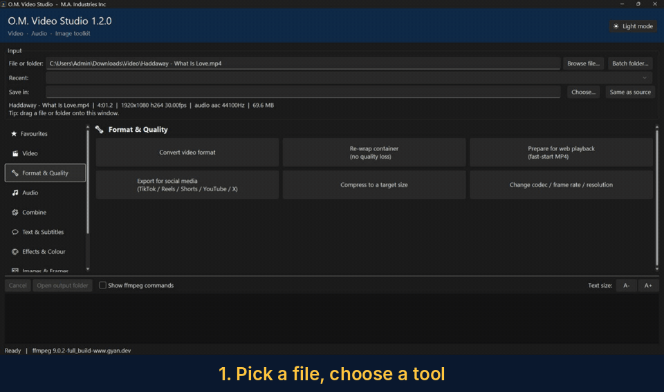
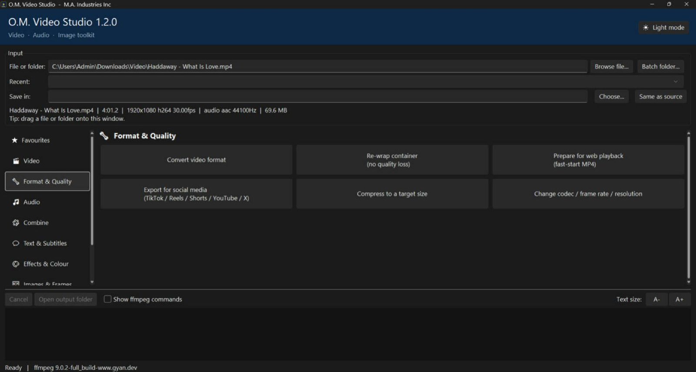
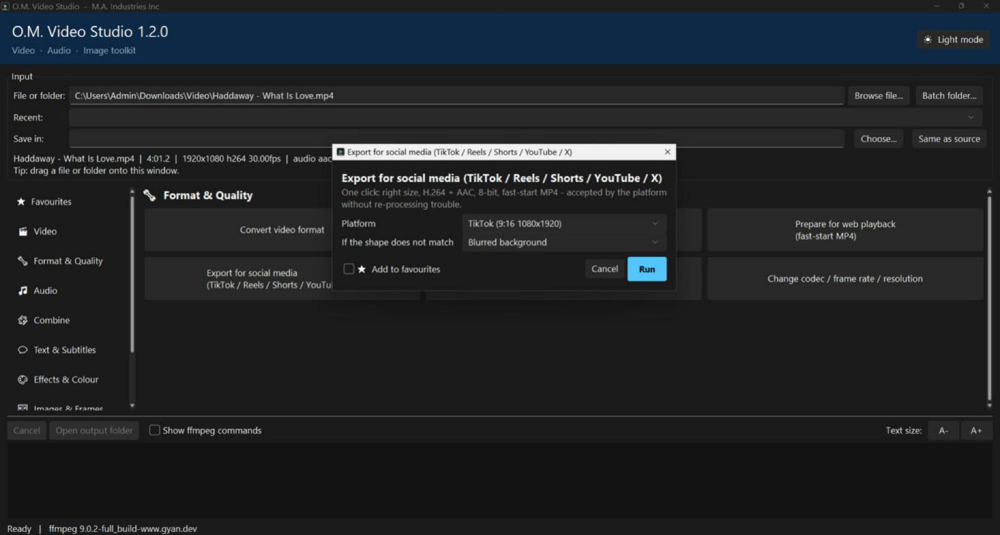
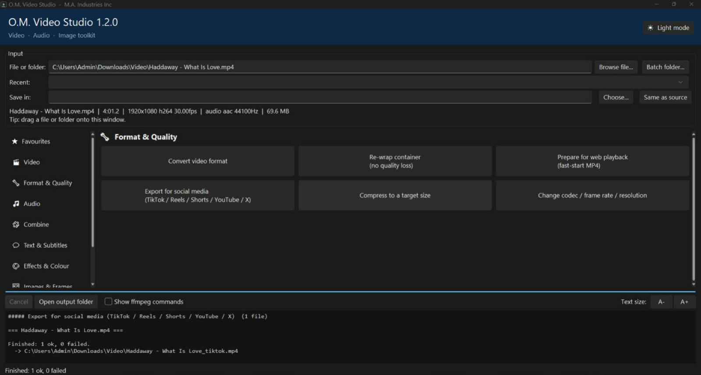

# O.M. Video Studio



Free point-and-click video, audio and image tools for Windows, powered by ffmpeg. Pick a file, press a button. No commands to learn.
Trim, join, split, convert, compress, extract audio, subtitles, effects, GIFs, thumbnails, one-click social-media export and more (70 operations).

## Screenshots

| Pick a tool | One-click social export | Finished |
|---|---|---|
| [](docs/images/main-window.png) | [](docs/images/social-export.png) | [](docs/images/finished-run.png) |

**New in 1.4.0:**
- **Sliders everywhere they make sense.** Trim, Trim audio, Thumbnail, GIF, Freeze frame, Split, Fades, Crop (width, height and position), Silence removal, text start/end times and more now have sliders under the boxes. Time boxes use a **minutes:seconds:milliseconds** counter (e.g. `001:22:400`), with -1s / -.1s / +.1s / +1s nudge buttons for exact cuts. Typing in the box moves the slider, and the other way round.
- **Live before/after preview for every video and image operation**, not just Trim and Crop. Change an option and the preview frame updates.

**New in 1.3.0:**
- **Job queue.** Select several files at once (Browse files… or drop them together), then use **Add to queue** in any operation's window. Line up different operations, reorder them in the **Queue** window and run the lot with one click.
- **Live preview for Trim and Crop.** The window shows the start and end frames of your cut, or the cropped result, and updates as you type.
- **Copy ffmpeg command.** Every operation window has a button that copies the exact ffmpeg command to the clipboard, and **Copy last command** in the bottom bar copies the one just run. Handy for learning ffmpeg or scripting.

**New in 1.2.0:** *Export for social media* under Format & Quality. Pick TikTok, Instagram Reels, YouTube Shorts, YouTube, X or Instagram feed, and the app resizes, re-encodes (H.264 + AAC, fast-start MP4) and fills any spare space with a blurred background, black bars or a crop.

## Install (Windows 10/11)

1. Go to **[Releases](../../releases/latest)** and download **`OM-Video-Studio-Setup.exe`**.
2. Run it. No admin rights needed, and **you do not need Python**.
   - Windows may show *"Windows protected your PC"* because the app is not code-signed. Click **More info → Run anyway**.
3. Launch **O.M. Video Studio**. If ffmpeg is not on your computer, the app offers to download it for you (about 100 MB, one time).

Prefer no installer? Download `OM-Video-Studio-Portable.zip`, unzip anywhere and run `OM-Video-Studio.exe`.

## Videos

- [Download and install](docs/videos/01-install-mobile.mp4): 49 s, portrait. Getting the installer and first launch.
- [Quick tour](docs/videos/02-quick-tour-mobile.mp4): 66 s, portrait. Pick a file, choose a tool, run it.
- [Full walkthrough](docs/videos/03-full-walkthrough-hd.mp4): about 5 min, 1080p. Every category, with real runs.

More detail in [docs/videos](docs/videos/README.md).

## Notes

- Formerly called *O.M. FFmpeg Studio* (versions 1.0.x). Installing 1.1+ over an old copy upgrades it and keeps your settings.

- Problems are written to `%LOCALAPPDATA%\O.M. Video Studio\om_video_studio_log.txt`. Attach it if you report a bug.
- The app checks GitHub for new releases at start-up and tells you when one is available.
- Uninstall from Windows Settings → Apps.

## Build from source

```
build.bat            # needs Python 3.10-3.13; add Inno Setup to also make the installer
```
Every push to `main` makes GitHub Actions build the installer and publish release `v<VERSION>` (the `VERSION` line in `om_video_studio.py`); bump it to ship a new version.
Run the app straight from source with `pip install -r requirements.txt` then `python om_video_studio.py`.

## Licence

App code: MIT (see `LICENSE`). ffmpeg is a separate project with its own licence; it is downloaded from its official build providers and is not included here.
