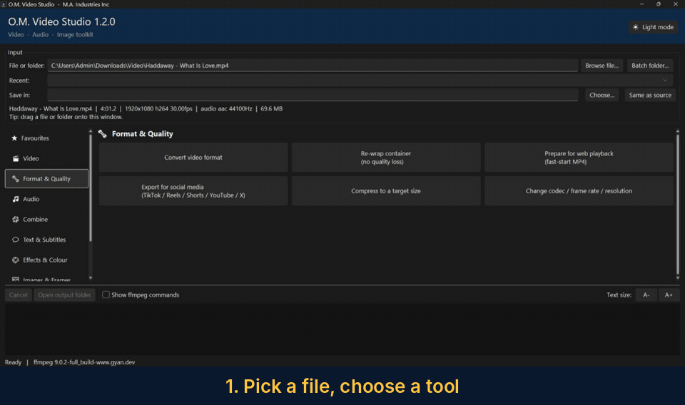
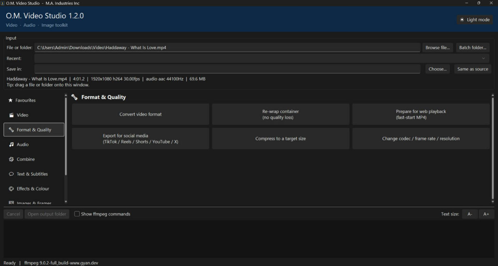
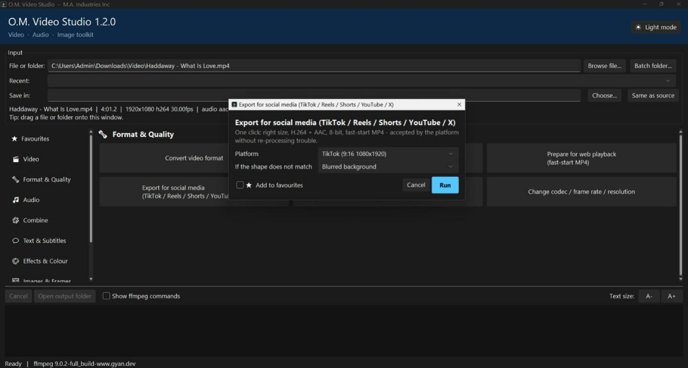
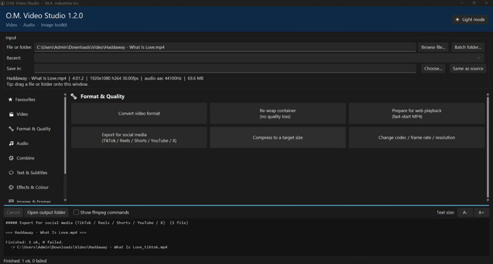

# O.M. Video Studio



Free point-and-click video, audio and image tools for Windows, powered by ffmpeg. Pick a file, press a button. No commands to learn.
Trim, join, split, convert, compress, extract audio, subtitles, effects, GIFs, thumbnails, one-click social-media export and more (70 operations).

## Screenshots

| Pick a tool | One-click social export | Finished |
|---|---|---|
| [](docs/images/main-window.png) | [](docs/images/social-export.png) | [](docs/images/finished-run.png) |

**New in 1.15.0:** **Uses your graphics card automatically.** NVIDIA, AMD, Intel and Apple hardware encoders are detected at start-up and used when found, with an automatic fall back to the CPU. A **Check GPU** button shows what was found and a **Use GPU** box turns it off. **New look:** the company is now O.M. Industries Inc, with a new logo in the header and a colour splash screen. **About button:** lists every tool with a description, and opens the [illustrated guide](docs/ABOUT.md) with a screenshot of every tool.

Older versions: see the [changelog](CHANGELOG.md).

## Install (Windows 10/11)

1. Go to **[Releases](../../releases/latest)** and download **`OM-Video-Studio-Setup.exe`**.
2. Run it. No admin rights needed, and **you do not need Python**.
   - Windows may show *"Windows protected your PC"* because the app is not code-signed. Click **More info → Run anyway**.
3. Launch **O.M. Video Studio**. If ffmpeg is not on your computer, the app offers to download it for you (about 100 MB, one time).

Prefer no installer? Download `OM-Video-Studio-Portable.zip`, unzip anywhere and run `OM-Video-Studio.exe`.

## Install on a Mac (experimental)

1. Download the right zip from **[Releases](../../releases/latest)**: `OM-Video-Studio-macOS-arm64.zip` for Apple Silicon (M1/M2/M3/M4), `OM-Video-Studio-macOS-intel.zip` for Intel Macs. (Apple menu > About This Mac shows which you have.)
2. Unzip it and drag **OM-Video-Studio** into Applications.
3. The app is not signed with an Apple Developer ID, so the first time macOS will say it cannot be opened. **Right-click (or Control-click) the app > Open > Open.** If it still refuses, run this once in Terminal: `xattr -dr com.apple.quarantine /Applications/OM-Video-Studio.app`
4. ffmpeg is not bundled. If it is missing the app tells you and copies the command: install [Homebrew](https://brew.sh), then run `brew install ffmpeg`, and restart the app.

Test files (two short clips and a photo, copyright-free) are in [docs/test-media](docs/test-media). Testing the Mac version? A step-by-step guide with a tick chart is in [docs/OM_Video_Studio_Mac_Tester_Guide.pdf](docs/OM_Video_Studio_Mac_Tester_Guide.pdf) (also [.docx](docs/OM_Video_Studio_Mac_Tester_Guide.docx)). Developer notes: [script brief](docs/SCRIPT_OVERVIEW.md) and [project overview](docs/PROJECT_OVERVIEW.md).

Mac notes: the GPU checkbox uses Apple VideoToolbox when it works, and Windows-only touches (title-bar colour) are skipped. Please report anything odd - include the log file at `~/Library/Application Support/O.M. Video Studio/om_video_studio_log.txt`.

## Videos

- [Download and install](docs/videos/01-install-mobile.mp4): 49 s, portrait. Getting the installer and first launch.
- [Quick tour](docs/videos/02-quick-tour-mobile.mp4): 66 s, portrait. Pick a file, choose a tool, run it.
- [Full walkthrough](docs/videos/03-full-walkthrough-hd.mp4): about 5 min, 1080p. Every category, with real runs.

More detail in [docs/videos](docs/videos/README.md).

## Notes

- Formerly called *O.M. FFmpeg Studio* (versions 1.0.x). Installing 1.1+ over an old copy upgrades it and keeps your settings.

- Problems are written to `%LOCALAPPDATA%\O.M. Video Studio\om_video_studio_log.txt`. Attach it if you report a bug.
- The app checks GitHub for new releases at start-up and tells you when one is available.
- Uninstall from Windows Settings → Apps.

## Build from source

```
build.bat            # needs Python 3.10-3.13; add Inno Setup to also make the installer
```
Every push to `main` makes GitHub Actions build the installer and publish release `v<VERSION>` (the `VERSION` line in `om_video_studio.py`); bump it to ship a new version.
Run the app straight from source with `pip install -r requirements.txt` then `python om_video_studio.py`.

## Licence

App code: MIT (see `LICENSE`). ffmpeg is a separate project with its own licence; it is downloaded from its official build providers and is not included here.
