# O.M. Video Studio - illustrated guide

Point-and-click ffmpeg for Windows, by **O.M. Industries Inc**. This guide shows every tool with a picture of its dialog, what it does and what you can change. Every picture was taken from the real app.

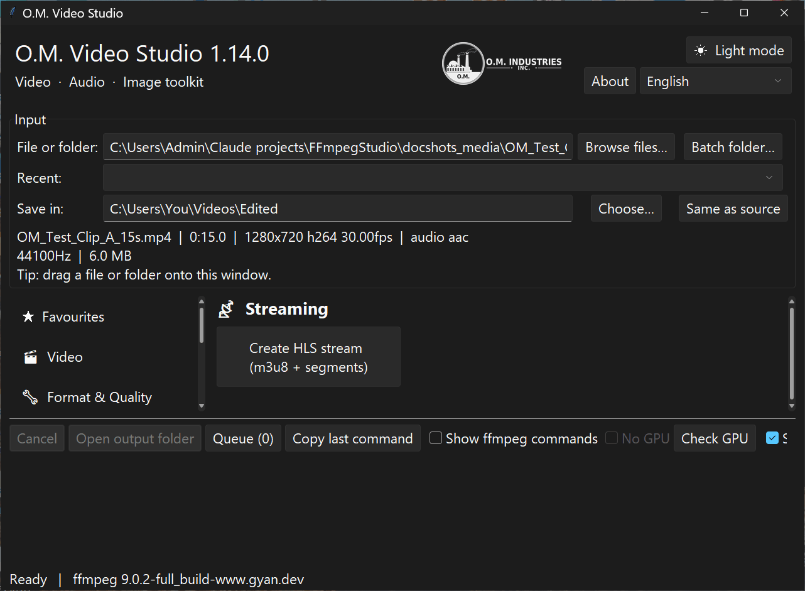

## How it works

1. Choose a file, several files or a whole folder (or drag them onto the window).
2. Choose where to save. Your original is never changed.
3. Pick a tool from the groups on the left, adjust the options, and press **Run** (or **Add to queue**).

Handy extras: **Copy ffmpeg command** shows the exact command, **Add to favourites** pins a tool to the top, and **Check GPU** tells you if graphics-card encoding is in use (NVIDIA, AMD, Intel or Apple, with automatic fall back to the CPU).

## Contents

- [Video](#video) - Cut, join, reshape and re-time video.
- [Format & Quality](#format-quality) - Change formats, shrink file sizes and prepare videos for social media and the web.
- [Audio](#audio) - Convert, clean up, fix the loudness of and add sound.
- [Images & Frames](#images-frames) - Grab frames, make GIFs and contact sheets, convert pictures.
- [Analysis](#analysis) - Look inside a file without changing it: reports, silences, scenes, loudness, waveforms.
- [Streaming](#streaming) - Prepare video for streaming from a website.
- [Combine](#combine) - Put clips, photos, logos and videos together.
- [Text & Subtitles](#text-subtitles) - Captions, subtitle files, titles and timers.
- [Effects & Colour](#effects-colour) - Colour, blur, fades, green screen and speed ramps.

## Video

Cut, join, reshape and re-time video.

### Trim / cut by time

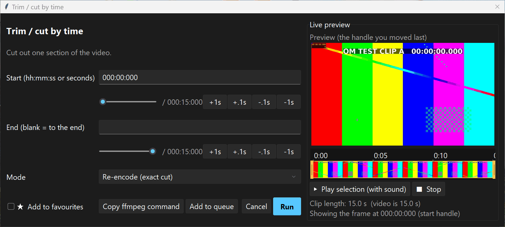

Cut one section out of a video. Type a start and end time (hh:mm:ss or plain seconds); leave End blank to go to the end. 'Re-encode' gives a frame-exact cut, 'Copy' is instant but cuts on the nearest keyframe. A film strip with draggable handles, a live preview and a Play selection button help you find the exact moment.

**Options:** Start (hh:mm:ss or seconds); End (blank = to the end); Mode (choice, default 'Re-encode (exact cut)') [Re-encode (exact cut), Copy (instant, cuts on keyframes)] - choices: Re-encode (exact cut), Copy (instant, cuts on keyframes)

### Join clips into one

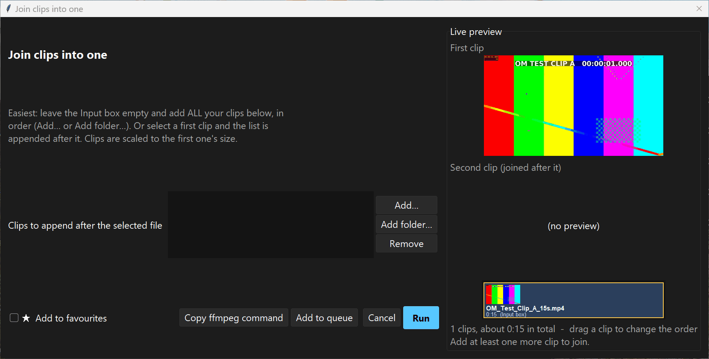

Join several clips into one video, in the order listed. Leave the Input box empty and add all your clips (or a whole folder) in the dialog, or pick a first clip and append the rest. A clip timeline lets you reorder them; everything is scaled to the first clip's size.

**Options:** Clips list (add files or a folder)

### Split into segments

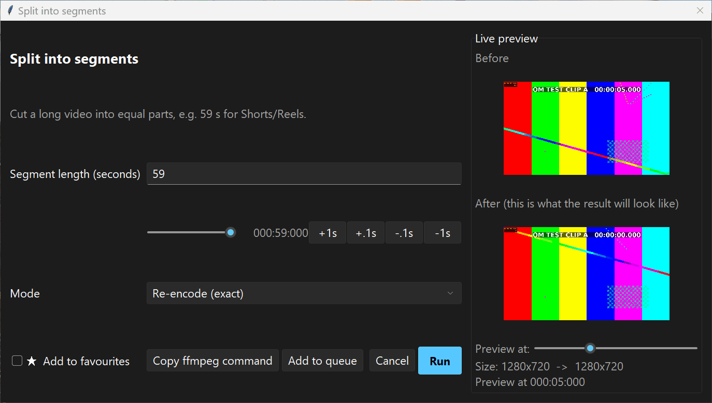

Cut a long video into equal-length parts, for example 59 seconds each for Shorts and Reels. Choose 'Re-encode' for exact lengths or 'Copy' for a fast cut on keyframes.

**Options:** Segment length (seconds); Mode (choice, default 'Re-encode (exact)') [Re-encode (exact), Copy (fast)] - choices: Re-encode (exact), Copy (fast)

### Change speed (slow-mo / time-lapse)

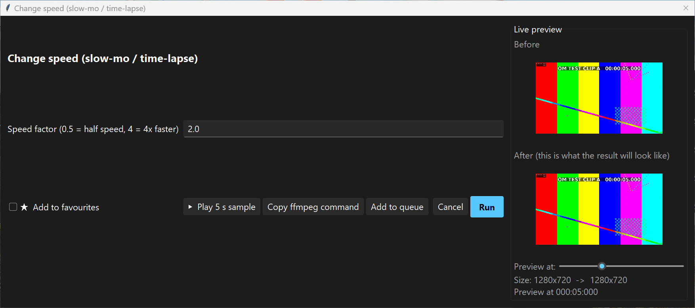

Slow motion or time-lapse for the whole clip. 0.5 is half speed, 2 is twice as fast. The sound is speeded or slowed to match, without changing its pitch.

**Options:** Speed factor (0.5 = half speed, 4 = 4x faster)

### Reverse playback

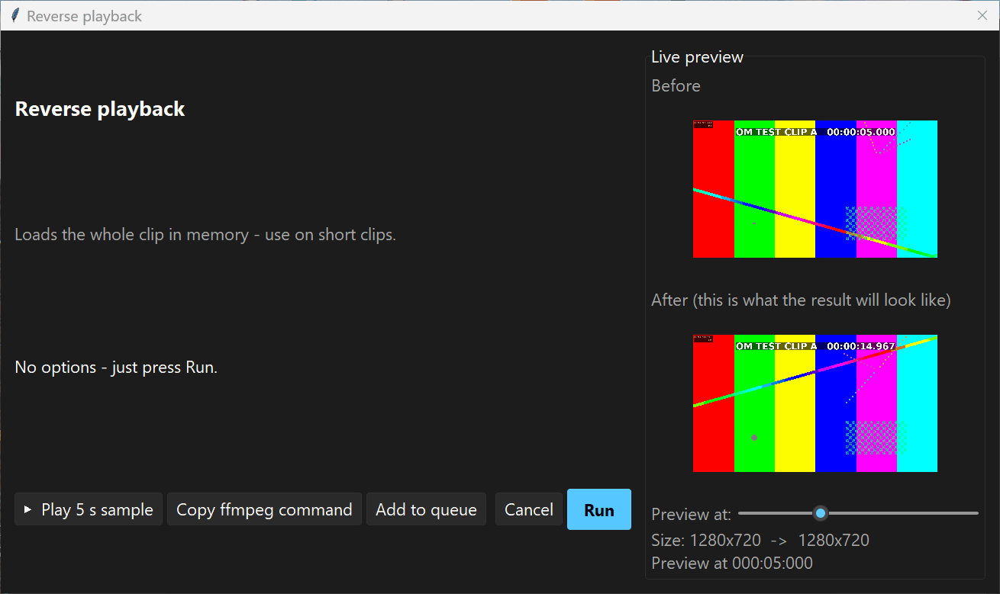

Play the clip backwards, picture and sound. The whole clip is held in memory, so use it on short clips.

### Resize

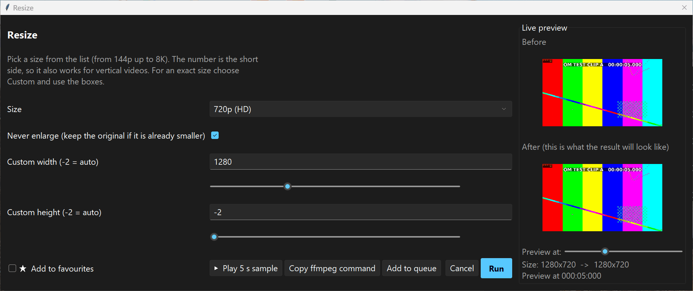

Change the picture size. Pick a size from 144p up to 8K (the number is the short side, so it works for vertical video too) or choose Custom and type a width and height. 'Never enlarge' keeps smaller videos as they are.

**Options:** Size (choice, default '720p (HD)') [144p, 240p, 320p, 360p, 480p, 540p, 720p (HD), 1080p (Full HD) ...] - choices: 144p, 240p, 320p, 360p, 480p, 540p, 720p (HD), 1080p (Full HD) ...; Never enlarge (keep the original if it is already smaller); Custom width (-2 = auto); Custom height (-2 = auto)

### Crop

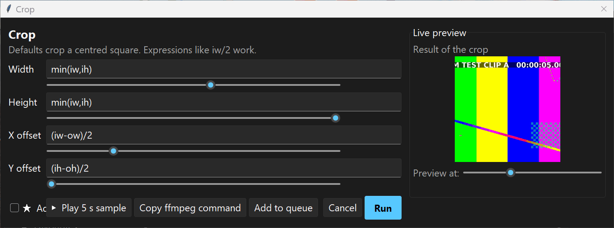

Cut away the edges of the picture. The defaults crop a centred square; the boxes accept numbers or expressions such as iw/2 (half the width).

**Options:** Width (text, default 'min(iw,ih)'); Height (text, default 'min(iw,ih)'); X offset (text, default '(iw-ow)/2'); Y offset (text, default '(ih-oh)/2')

### Rotate

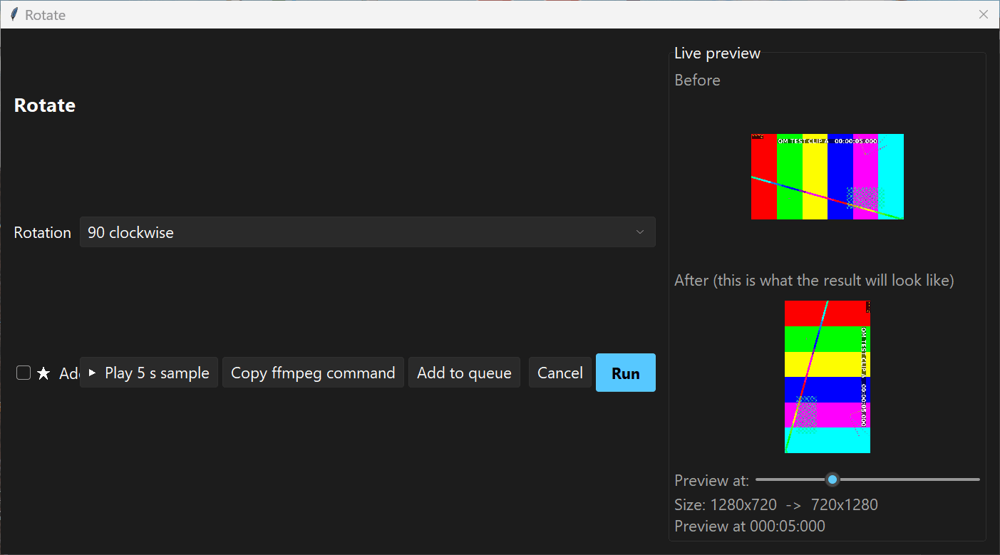

Turn the picture 90 degrees clockwise, 90 counter-clockwise or 180 degrees. Handy for phone clips that came out sideways.

**Options:** Rotation - choices: 90 clockwise, 90 counter-clockwise, 180

### Flip / mirror

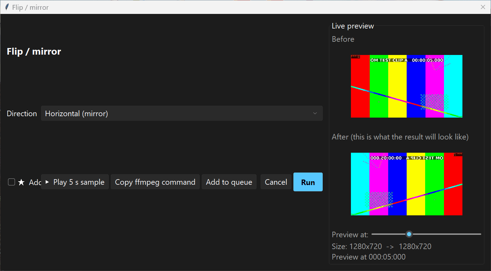

Mirror the picture horizontally, flip it vertically, or both.

**Options:** Direction (choice, default 'Horizontal (mirror)') [Horizontal (mirror), Vertical, Both] - choices: Horizontal (mirror), Vertical, Both

### Change aspect ratio (TikTok / Reels / Shorts)

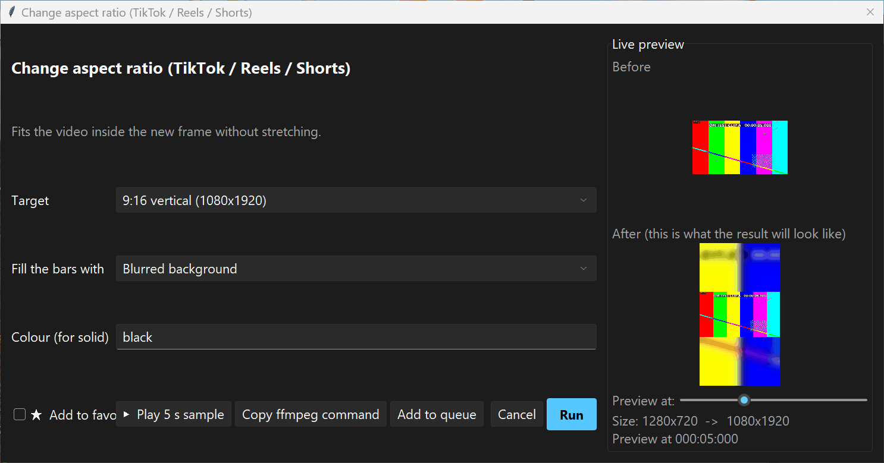

Reshape a video for TikTok, Reels or Shorts (9:16), square (1:1), portrait (4:5) or landscape (16:9) without stretching it. The empty bars can be filled with a blurred copy of the video, a solid colour, or you can crop to fill the frame.

**Options:** Target (choice, default '9:16 vertical (1080x1920)') [9:16 vertical (1080x1920), 1:1 square (1080x1080), 4:5 portrait (1080x1350), 16:9 landscape (1920x1080)] - choices: 9:16 vertical (1080x1920), 1:1 square (1080x1080), 4:5 portrait (1080x1350), 16:9 landscape (1920x1080); Fill the bars with - choices: Blurred background, Solid colour, Crop to fill; Colour (for solid)

### Loop the clip

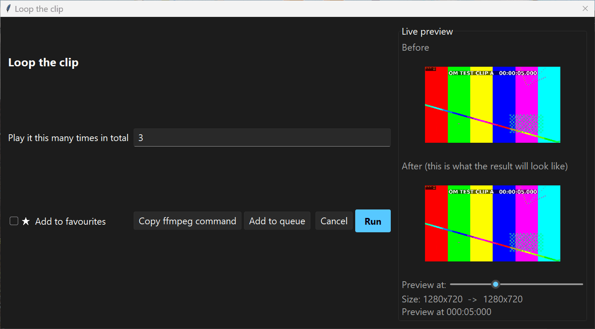

Repeat a clip a chosen number of times to make a longer video, for example a short background loop.

**Options:** Play it this many times in total

### Stabilise shaky footage

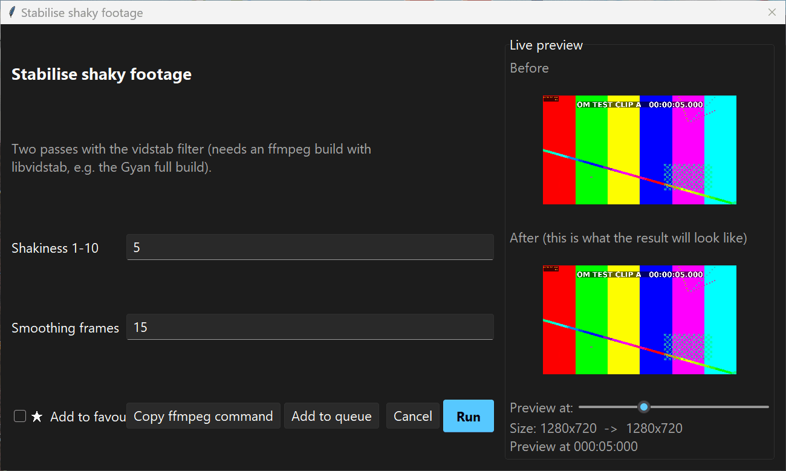

Smooth out shaky hand-held footage with a two-pass stabiliser. Shakiness says how bad the shake is; Smoothing says how much to even it out. Needs an ffmpeg build that includes libvidstab (the Gyan 'full' build does).

**Options:** Shakiness 1-10; Smoothing frames

### Freeze a frame

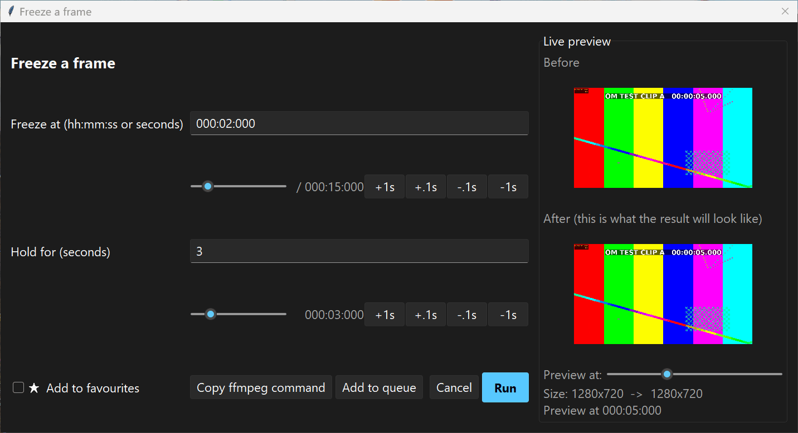

Pause the picture on one moment and hold it for a few seconds, then carry on. Type the time to freeze at and how long to hold.

**Options:** Freeze at (hh:mm:ss or seconds); Hold for (seconds)

## Format & Quality

Change formats, shrink file sizes and prepare videos for social media and the web.

### Convert video format

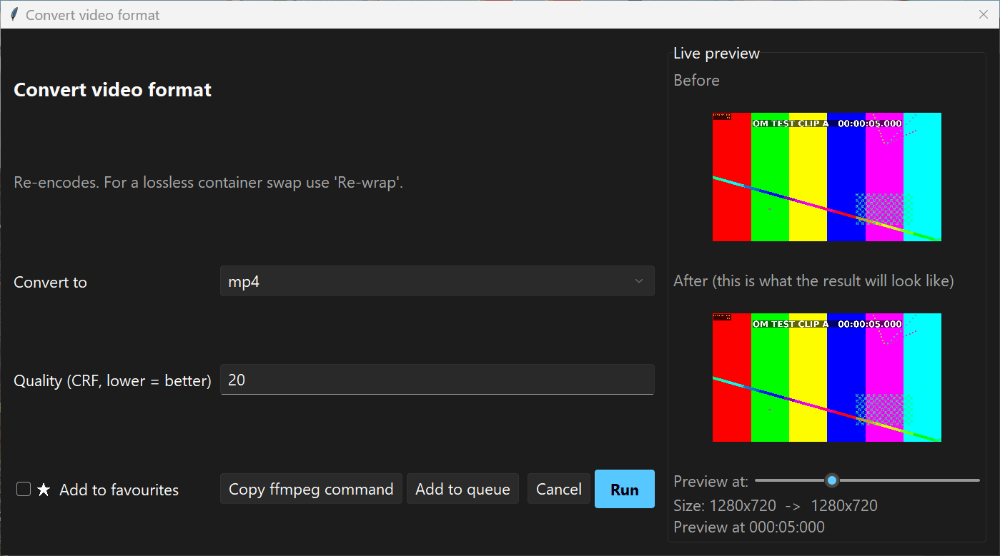

Change a video to another format: mp4, mov, mkv, webm, avi or an animated GIF. The video is re-encoded; lower Quality (CRF) numbers mean better quality and bigger files. For a lossless swap use Re-wrap instead.

**Options:** Convert to - choices: mp4, mov, mkv, webm, avi, gif; Quality (CRF, lower = better)

### Re-wrap container (no quality loss)

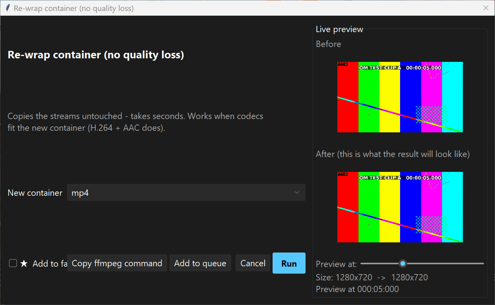

Move the video and sound into a different container (mp4, mkv or mov) without re-encoding. It takes seconds and loses no quality, as long as the codecs fit the new container.

**Options:** New container - choices: mp4, mkv, mov

### Prepare for web playback (fast-start MP4)

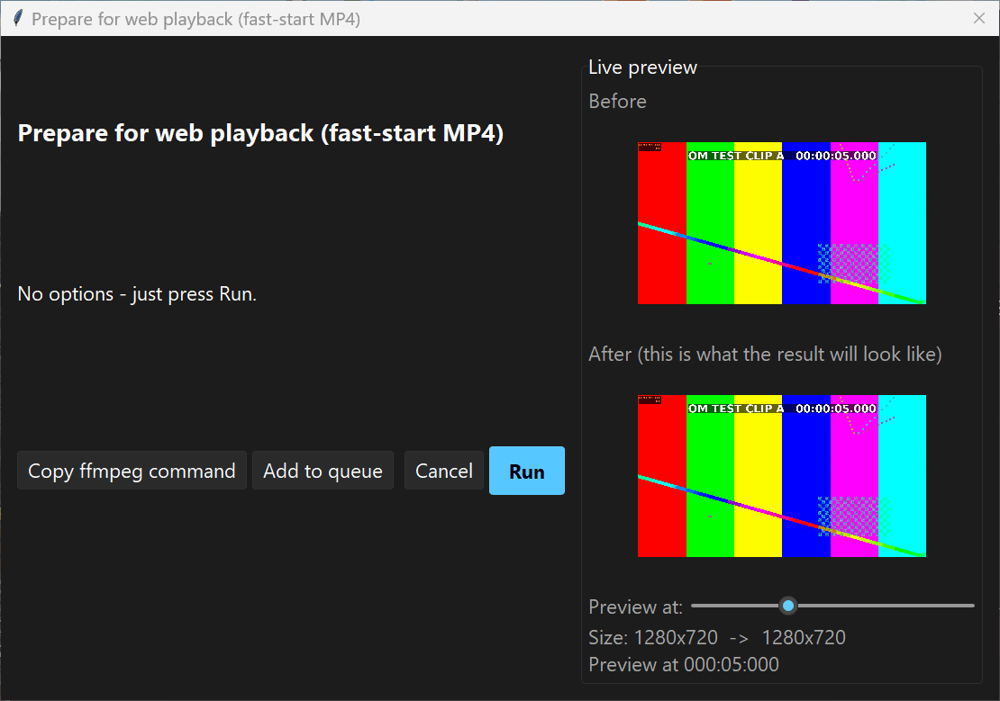

Reorder an MP4 so it starts playing straight away on a website or phone before it has finished downloading. Nothing is re-encoded, so it is instant.

### Export for social media (TikTok / Reels / Shorts / YouTube / X)

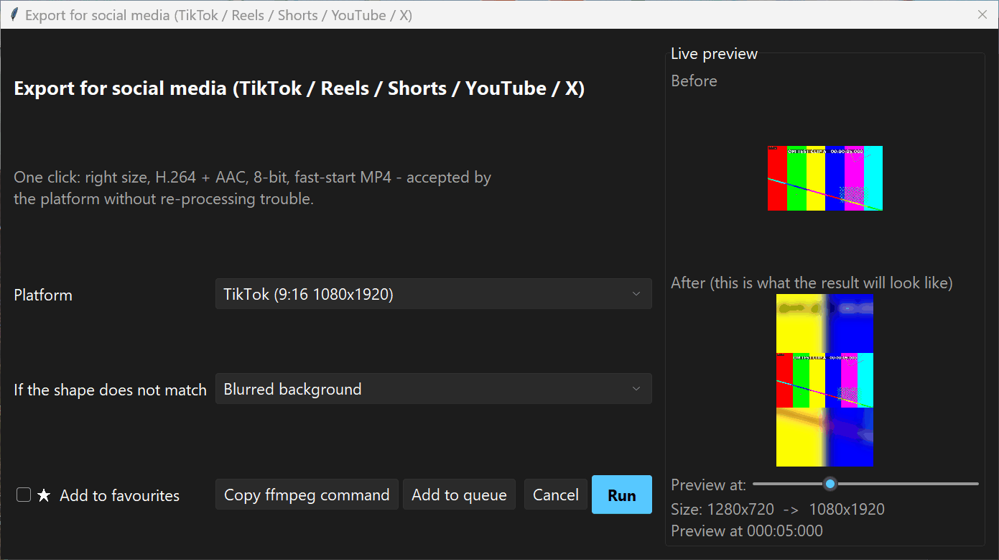

One click to make a video that TikTok, Instagram Reels, YouTube Shorts, YouTube, X or an Instagram feed post will accept: the right size, H.264 video, AAC sound and a fast-start MP4. If the shape does not match you choose blurred background, black bars or crop to fill.

**Options:** Platform (choice, default 'TikTok (9:16 1080x1920)') [TikTok (9:16 1080x1920), Instagram Reels (9:16 1080x1920), YouTube Shorts (9:16 1080x1920), YouTube (16:9 1080p), X / Twitter (16:9 1280x720), Instagram feed (4:5 1080x1350)] - choices: TikTok (9:16 1080x1920), Instagram Reels (9:16 1080x1920), YouTube Shorts (9:16 1080x1920), YouTube (16:9 1080p), X / Twitter (16:9 1280x720), Instagram feed (4:5 1080x1350); If the shape does not match - choices: Blurred background, Black bars, Crop to fill

### Compress to a target size

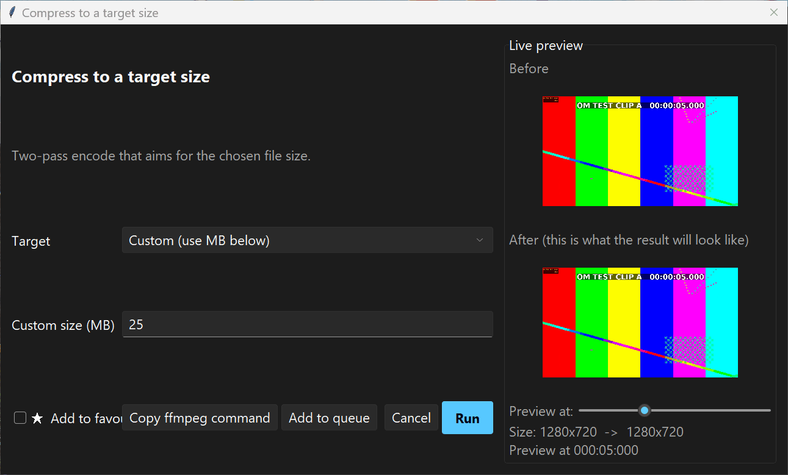

Shrink a video to a target file size with a two-pass encode. Pick a ready-made limit (Discord 25 MB, WhatsApp 16 MB, email 10 MB, Telegram 50 MB) or type your own size in MB.

**Options:** Target (choice, default 'Custom (use MB below)') [Custom (use MB below), Discord 25 MB, WhatsApp 16 MB, Email 10 MB, Telegram 50 MB] - choices: Custom (use MB below), Discord 25 MB, WhatsApp 16 MB, Email 10 MB, Telegram 50 MB; Custom size (MB)

### Change codec / frame rate / resolution

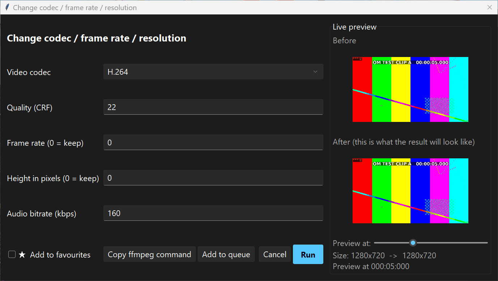

Full control over how the video is encoded: codec (H.264, H.265 or VP9), quality, frame rate, height in pixels and audio bitrate. Use 0 to keep the frame rate or height as it is.

**Options:** Video codec - choices: H.264, H.265 (HEVC), VP9; Quality (CRF); Frame rate (0 = keep); Height in pixels (0 = keep); Audio bitrate (kbps)

## Audio

Convert, clean up, fix the loudness of and add sound.

### Extract audio from video

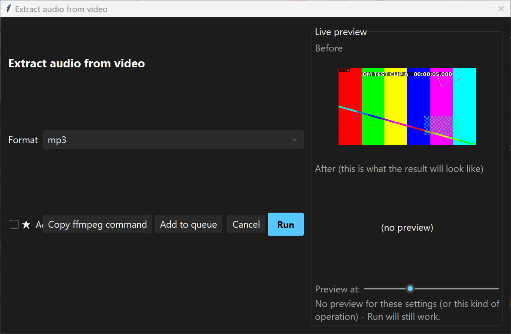

Pull the sound out of a video and save it as mp3, wav, m4a, flac, ogg or opus.

**Options:** Format - choices: mp3, wav, m4a, flac, ogg, opus

### Convert audio format

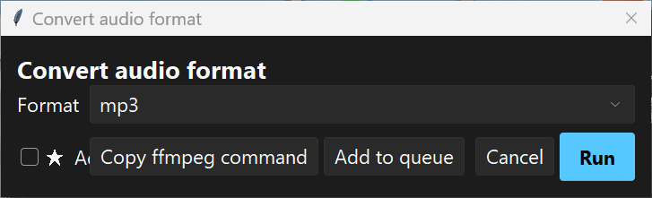

Convert an audio file to another format: mp3, wav, m4a, flac, ogg or opus.

**Options:** Format - choices: mp3, wav, m4a, flac, ogg, opus

### Normalise loudness

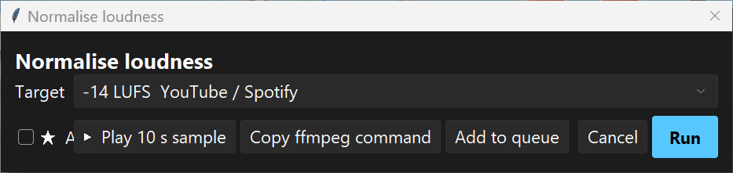

Even out the loudness to a standard target: -14 LUFS for YouTube and Spotify, -16 for podcasts and Apple, or -23 for broadcast. Works on audio and video files.

**Options:** Target - choices: -14 LUFS  YouTube / Spotify, -16 LUFS  Podcast / Apple, -23 LUFS  Broadcast (EBU R128)

### Remove silence

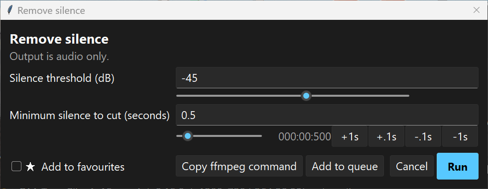

Cut out the quiet gaps from a recording. Set how quiet counts as silence (dB) and how long a gap must last before it is removed. The result is audio only.

**Options:** Silence threshold (dB); Minimum silence to cut (seconds)

### Trim audio

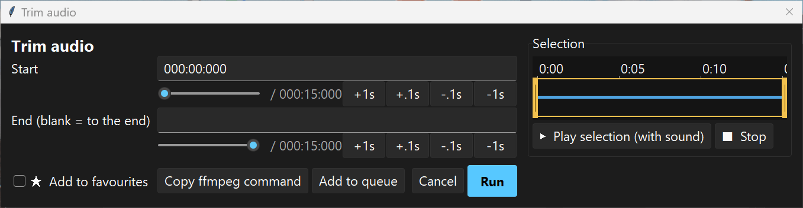

Cut one section out of an audio file. Type a start and end time; leave End blank to go to the end. Has the same film strip and live preview as Trim, with a waveform.

**Options:** Start; End (blank = to the end)

### Fade in / out

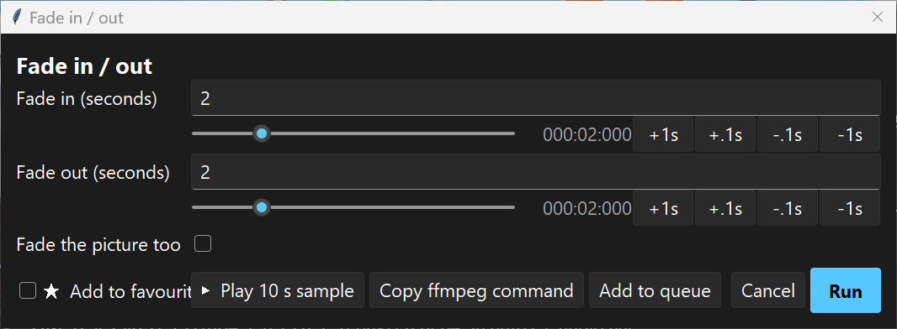

Fade the sound in at the start and out at the end, with the length of each in seconds. Tick 'Fade the picture too' to fade a video's picture as well.

**Options:** Fade in (seconds); Fade out (seconds); Fade the picture too

### Change volume

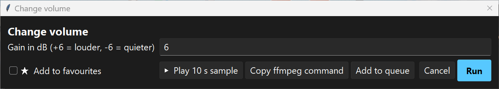

Make the sound louder or quieter. Gain is in decibels: +6 is roughly twice as loud, -6 roughly half.

**Options:** Gain in dB (+6 = louder, -6 = quieter)

### Change audio speed (keeps pitch)

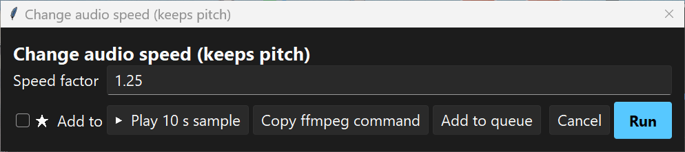

Speed up or slow down audio without changing its pitch, so voices do not turn into chipmunks. 1.25 is a quarter faster.

**Options:** Speed factor

### Change pitch

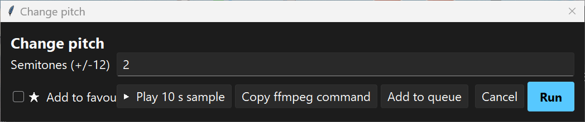

Raise or lower the pitch in semitones (up to 12 either way) while keeping the speed the same.

**Options:** Semitones (+/-12)

### Denoise

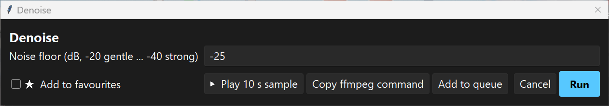

Reduce steady background hiss and hum in a recording. A noise floor of -25 dB is gentle; -40 dB is strong.

**Options:** Noise floor (dB, -20 gentle ... -40 strong)

### High-pass / low-pass filter

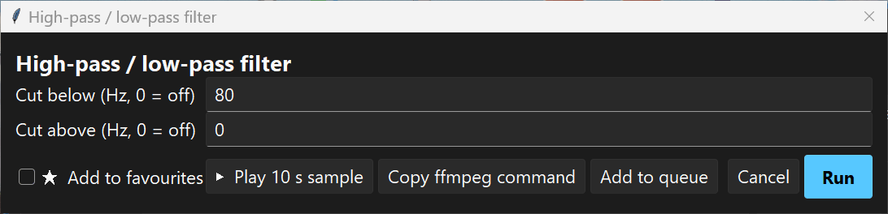

A simple high-pass and low-pass filter. Cut below a frequency to remove rumble (80 Hz is common) and/or cut above a frequency to remove hiss. 0 turns a side off.

**Options:** Cut below (Hz, 0 = off); Cut above (Hz, 0 = off)

### Add music / replace audio

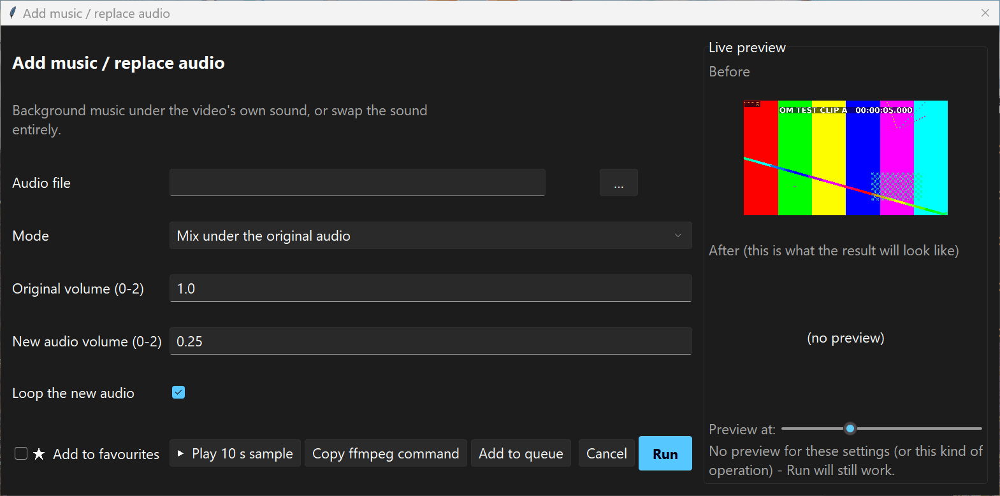

Add background music under a video's own sound, or replace the sound completely. Choose the music file, set both volumes (the music defaults to a quiet 0.25) and tick Loop to repeat short music for the whole video.

**Options:** Audio file; Mode - choices: Mix under the original audio, Replace the original audio; Original volume (0-2); New audio volume (0-2); Loop the new audio

### Add narration / voiceover

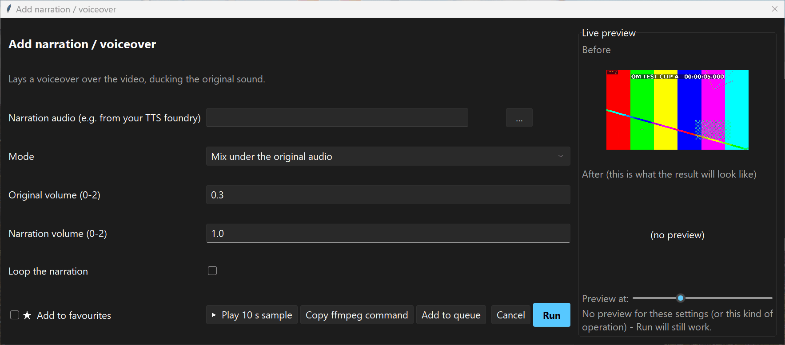

Lay a voiceover on a video. The original sound is turned down (ducked) under the narration, or replaced entirely. Made for recordings from the Narration Engine, but any audio file works.

**Options:** Narration audio (e.g. from your TTS foundry); Mode - choices: Mix under the original audio, Replace the original audio; Original volume (0-2); Narration volume (0-2); Loop the narration

### Mono / split stereo channels

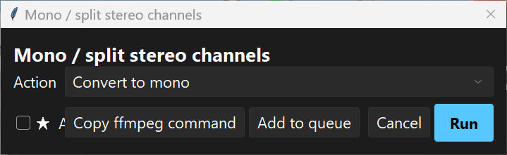

Turn stereo sound into mono, or split it into separate left and right files.

**Options:** Action - choices: Convert to mono, Split into left + right files

## Images & Frames

Grab frames, make GIFs and contact sheets, convert pictures.

### Grab a thumbnail / single frame

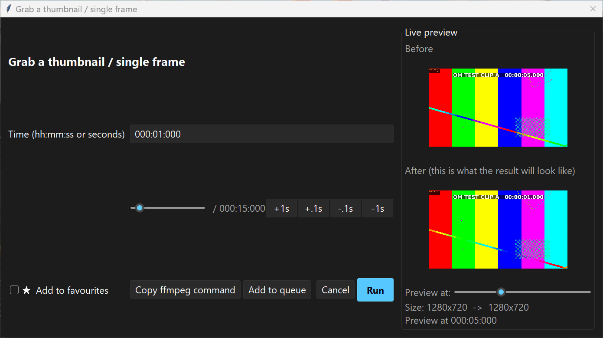

Save a single frame from the video as a picture. Type the time to grab it from. A slider with a live picture lets you find the right frame.

**Options:** Time (hh:mm:ss or seconds)

### Extract frames to a folder

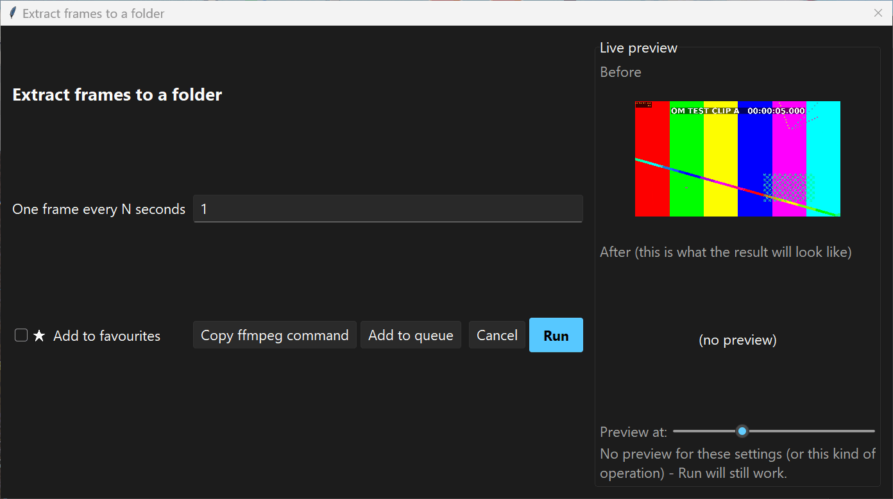

Save a series of pictures from the video into a folder, one every N seconds.

**Options:** One frame every N seconds

### Contact sheet (grid of frames)

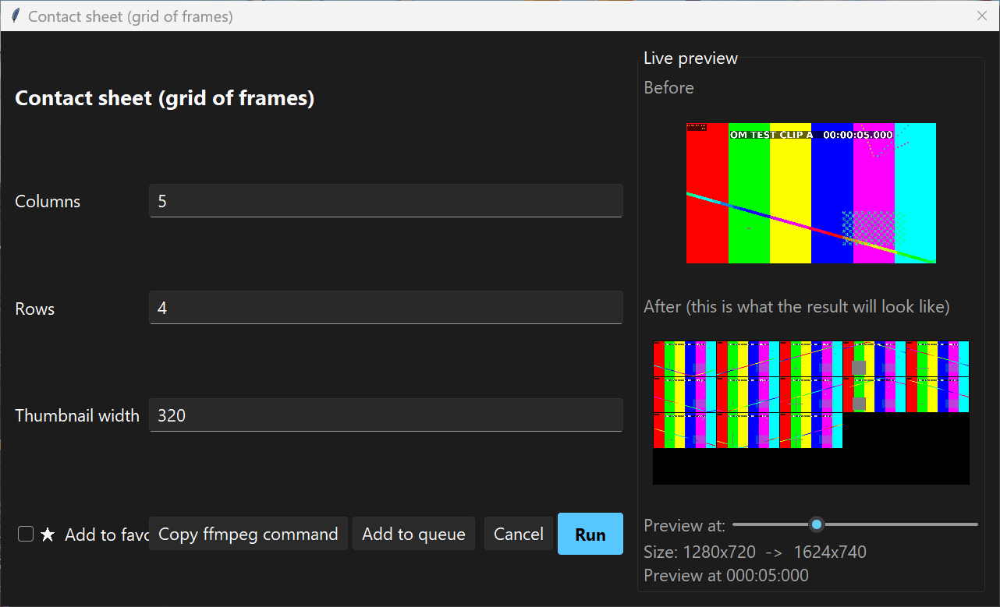

Make one picture showing a grid of frames from across the whole video, like a contact sheet. Choose the number of columns, rows and the thumbnail width.

**Options:** Columns; Rows; Thumbnail width

### Make a GIF (optimised palette)

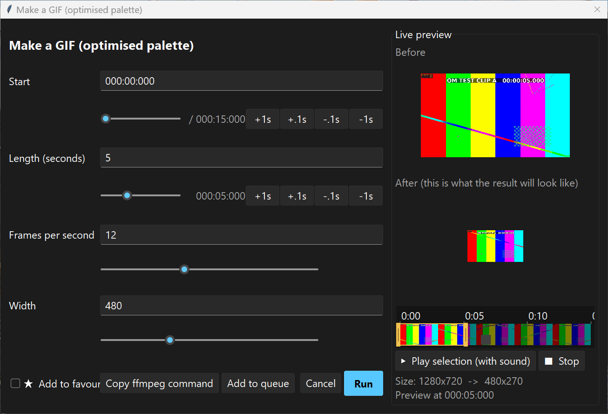

Turn a section of a video into an animated GIF with an optimised colour palette. Set the start, length, frames per second and width. The film strip shows the section as a window you can drag.

**Options:** Start; Length (seconds); Frames per second; Width

### Convert / resize image

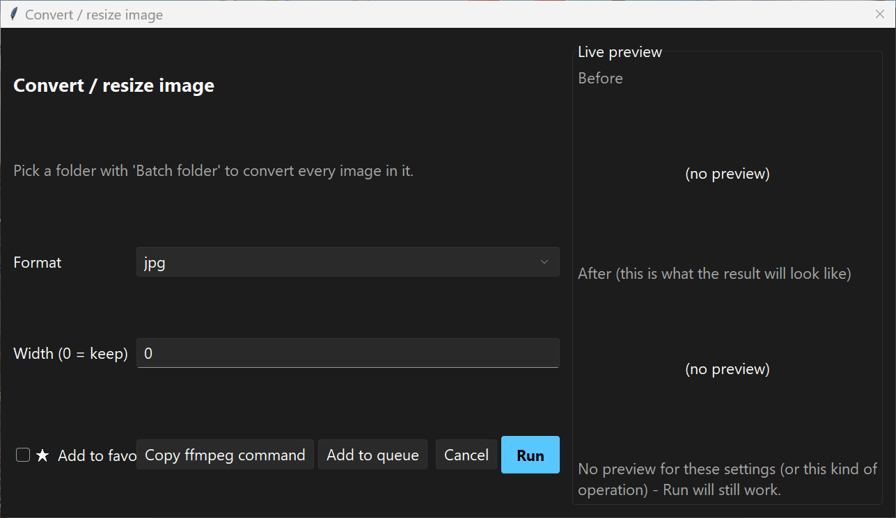

Convert a picture to jpg, png or webp and optionally resize it. Choose 'Batch folder' at the top to convert every image in a folder at once.

**Options:** Format - choices: jpg, png, webp; Width (0 = keep)

## Analysis

Look inside a file without changing it: reports, silences, scenes, loudness, waveforms.

### Full file report (ffprobe)

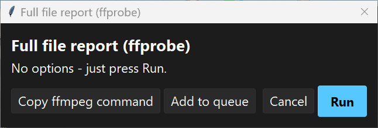

Write a full technical report about a file (codecs, size, bitrate, tracks, metadata) to a text file, using ffprobe.

### Detect silences

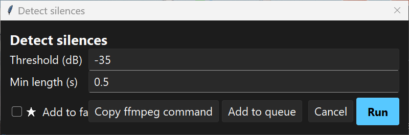

List where the quiet gaps are in a file, with start times and lengths, without changing the file.

**Options:** Threshold (dB); Min length (s)

### Detect black frames

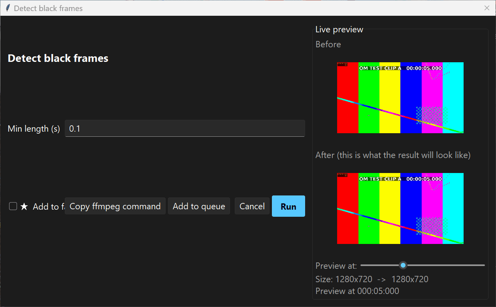

List where black frames appear in a video, handy for finding fades and bad cuts.

**Options:** Min length (s)

### Detect frozen frames

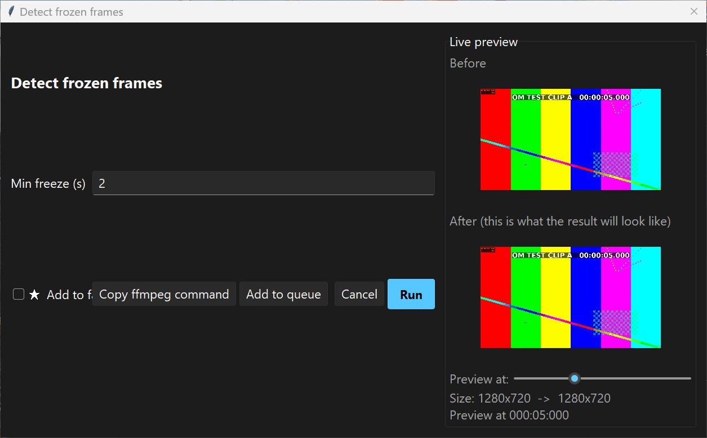

List where the picture is frozen for longer than a chosen time, handy for spotting dropped frames.

**Options:** Min freeze (s)

### Detect scene changes

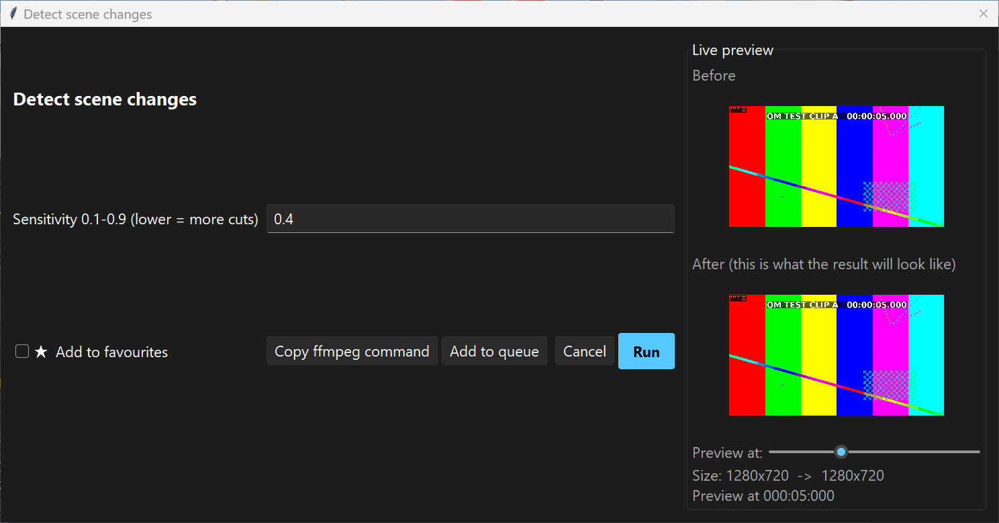

List the times where the scene changes. Lower sensitivity numbers find more cuts.

**Options:** Sensitivity 0.1-0.9 (lower = more cuts)

### Measure loudness (LUFS)

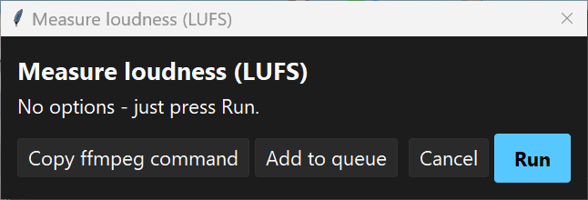

Measure how loud a file is (integrated LUFS, loudness range, true peak) without changing it.

### Waveform image

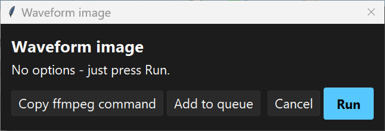

Draw the sound as a waveform picture.

### Spectrogram image

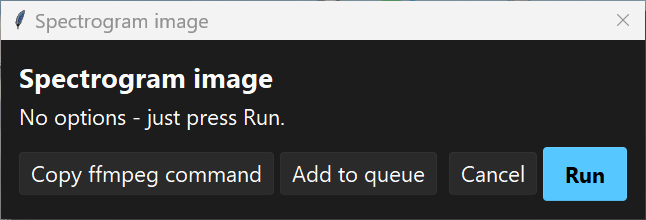

Draw the sound as a spectrogram picture, showing how the frequencies change over time.

### Strip metadata (no re-encode)

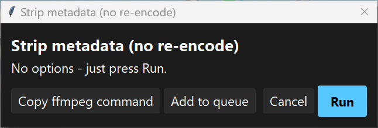

Remove the hidden metadata (location, device, title and so on) from a file without re-encoding, so there is no quality loss.

## Streaming

Prepare video for streaming from a website.

### Create HLS stream (m3u8 + segments)

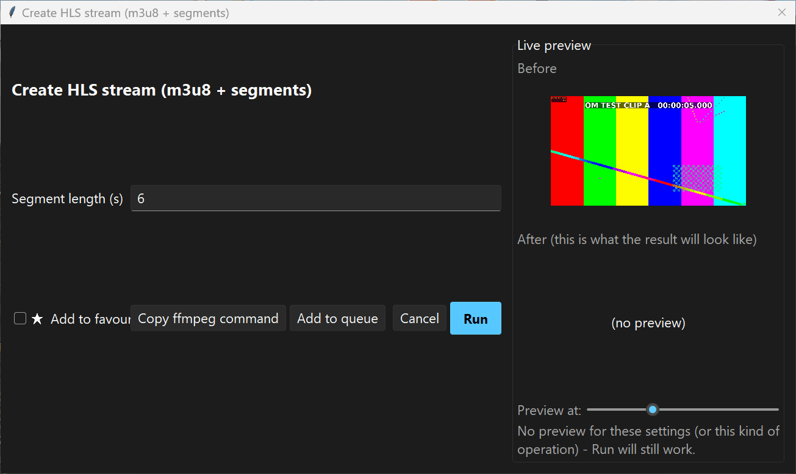

Cut a video into small pieces with a playlist (.m3u8) so it can be streamed from a website. Choose how long each piece is.

**Options:** Segment length (s)

## Combine

Put clips, photos, logos and videos together.

### Add logo / watermark

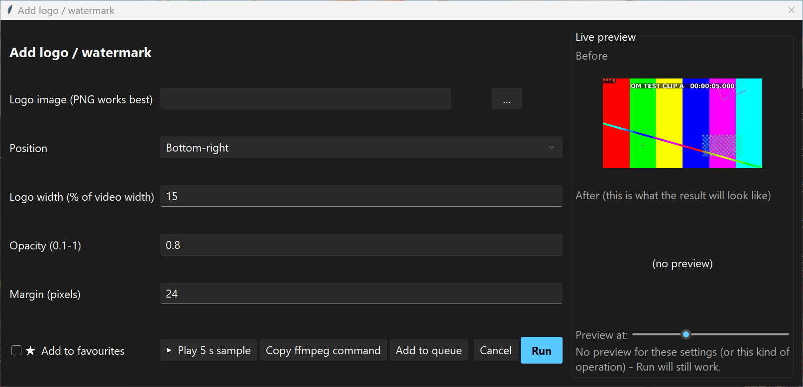

Put your logo on a video. Choose the logo picture (PNG with transparency works best), where it goes, how wide it is as a percentage of the video, its opacity and the margin.

**Options:** Logo image (PNG works best); Position - choices: Bottom-right, Bottom-left, Top-right, Top-left, Centre; Logo width (% of video width); Opacity (0.1-1); Margin (pixels)

### Picture-in-picture (small video over big)

Show a small video in the corner of a bigger one (picture-in-picture). Choose the small video, its corner, its size as a percentage of the main video and the margin.

**Options:** Small video; Position - choices: Bottom-right, Bottom-left, Top-right, Top-left, Centre; Small video width (% of main); Margin (pixels)

### Side-by-side / grid of videos

Put several videos on screen at once: side by side, stacked, or in a 2-column grid. Add the clips in the dialog; the sound comes from the first video.

**Options:** Other videos to add; Layout - choices: Side by side, Stacked, Grid (2 columns); Width of each cell

### Join clips with crossfade transitions

Join clips with a transition between them. Choose the transition length and a style such as fade, dissolve, fade to black, wipe, slide or circle open. Each clip must be longer than the transition.

**Options:** Clips list (add files or a folder); Transition length (seconds); Style - choices: fade, dissolve, fadeblack, wipeleft, wiperight, slideleft, slideright, circleopen ...

### Photos to video (slideshow / Ken Burns)

Turn photos into a video with an optional slow zoom (Ken Burns) effect. Add photos or a folder, choose seconds per photo, effect, video size, crossfade length and optional music.

**Options:** More photos to add; Seconds per photo; Effect - choices: Slow zoom in, Slow zoom out, None (still); Video size - choices: 1920x1080 landscape, 1080x1920 vertical, 1080x1080 square; Crossfade between photos (seconds, 0 = cut); Music (optional)

## Text & Subtitles

Captions, subtitle files, titles and timers.

### Burn in captions (SRT / ASS)

Burn captions permanently into the picture from an .srt or .ass file. Choose font size, position (bottom, middle, top) and outline thickness.

**Options:** Subtitle file (.srt / .ass); Font size; Position - choices: Bottom, Middle, Top; Outline thickness

### Add a soft subtitle track (can be turned off)

Add a subtitle track to a video that viewers can switch on and off. Choose the .srt file and its language code (eng, urd, pan and so on). No re-encoding.

**Options:** Subtitle file (.srt); Language code (eng, urd, pan...)

### Extract subtitles from a video

Save a video's built-in subtitles as an srt, ass or vtt file. Choose which subtitle track to take.

**Options:** Save as - choices: srt, ass, vtt; Subtitle track number (1 = first)

### Convert subtitle file format

Convert a subtitle file between srt, ass and vtt. Select the subtitle file as the Input first.

**Options:** Convert to - choices: srt, ass, vtt

### Add a title / lower third

Write a title or lower third on the video. Choose the text, position, size, colour, an optional dark box behind it, and the times it appears and disappears.

**Options:** Text; Position - choices: Bottom, Middle, Top, Lower third, Top-left, Top-right, Bottom-left, Bottom-right; Font size; Colour; Dark box behind the text; Show from (seconds); Hide at (blank = until the end)

### Add a timer / countdown

Put a running clock on the video: count up from 0 or count down from a number of seconds. Choose position, size, colour and an optional dark box.

**Options:** Type - choices: Count up from 0, Count down from…; Countdown from (seconds); Position - choices: Bottom, Middle, Top, Lower third, Top-left, Top-right, Bottom-left, Bottom-right; Font size; Colour; Dark box behind the text

## Effects & Colour

Colour, blur, fades, green screen and speed ramps.

### Colour correction (brightness, contrast…)

Adjust brightness, contrast, saturation and gamma. The defaults give a small, pleasing lift. The dialog shows a preview of the result, and a Play sample button.

**Options:** Brightness (-0.5 to 0.5); Contrast (0.5 to 2); Saturation (0 to 3); Gamma (0.5 to 2)

### Apply a LUT (.cube colour preset)

Apply a colour 'look' from a .cube LUT file, like the presets sold for cinematic grading.

**Options:** LUT file (.cube)

### Blur

Blur the whole picture. Strength runs from 1 to 30.

**Options:** Strength (1-30)

### Sharpen

Make the picture crisper. Strength runs from 0.5 to 3.

**Options:** Strength (0.5-3)

### Denoise video

Reduce grain and noise in the picture. Strength runs from 1 to 10.

**Options:** Strength (1-10)

### Vignette (darkened corners)

Darken the corners of the picture for a focused, cinematic look. Lower numbers give a stronger effect.

**Options:** Strength (0.2-1.2, lower = stronger)

### Remove green screen (chroma key)

Remove a green screen (or any single colour) and replace it with a picture or a solid colour. Choose the key colour, how similar a colour must be to count, and how soft the edge is.

**Options:** Key colour; Similarity (0.05-0.4); Edge softness (0-0.3); Background image (optional); …or background colour

### Fade in / out (picture + sound)

Fade the picture and sound in at the start and out at the end, to black or to white.

**Options:** Fade in (seconds); Fade out (seconds); Fade to / from - choices: black, white

### Black and white

Turn colour footage black and white, or give it a sepia (old photograph) tint.

**Options:** Look - choices: Black & white, Sepia

### Speed ramp (slow down or speed up a section)

Slow down or speed up just one section of the video while the rest plays normally. Choose where the section starts and ends and its speed (0.25 is slow motion, 3 is fast).

**Options:** Section starts at (seconds); Section ends at (seconds); Speed in the section (0.25 = slow-mo, 3 = fast)

### Deinterlace old footage

Remove the comb-like lines from old interlaced footage, such as video from old camcorders or TV recordings.

## Graphics-card (GPU) encoding

The app looks for an NVIDIA, AMD, Intel or Apple hardware encoder and uses it automatically when it finds one, otherwise it uses the CPU. **Check GPU** shows what was found; the **Use GPU** box turns it off.
